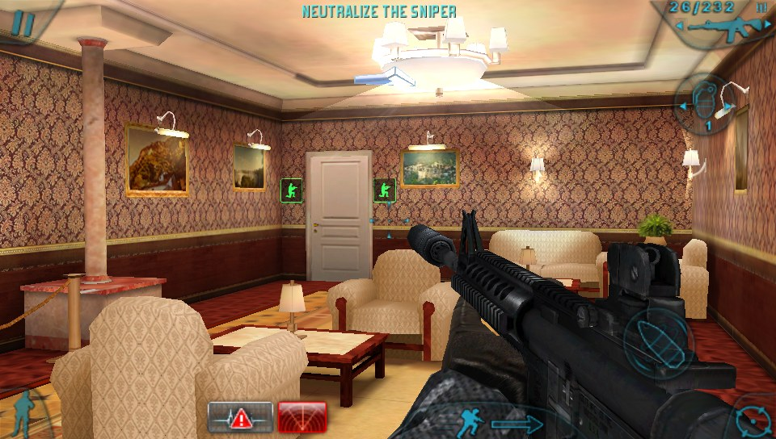
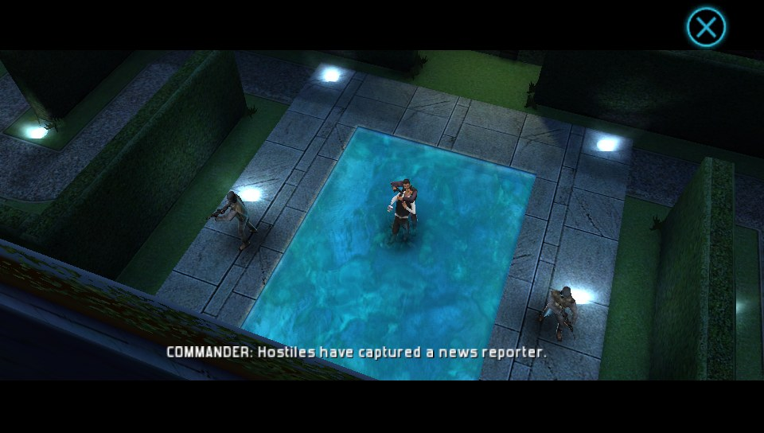
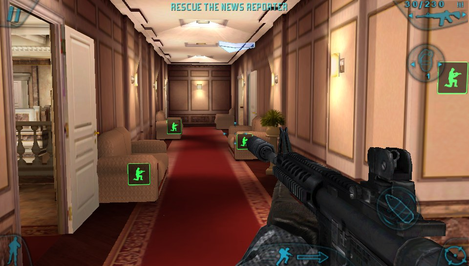
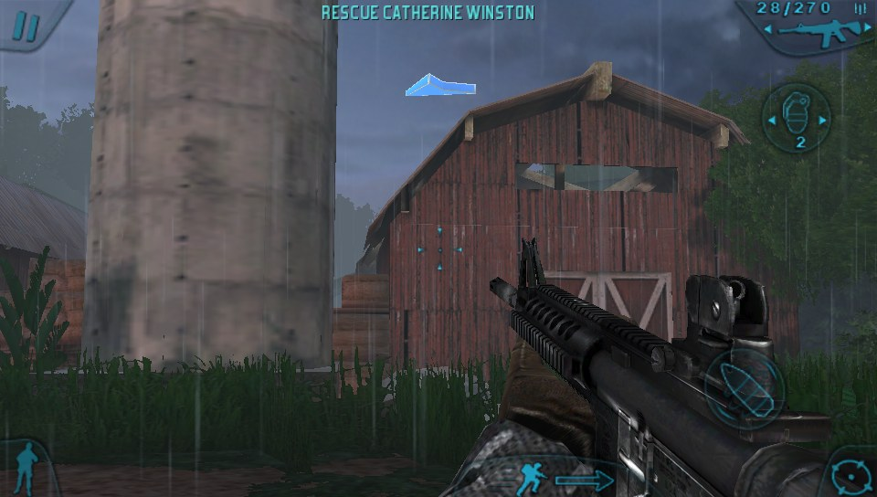

# R6SV Reloaded

A loader that runs the Android version of *Tom Clancy's Rainbow Six: Shadow
Vanguard* (Gameloft, 2011) on Windows and on the PS Vita, with controller
support.

The loader puts the game's own ARM library (`librainbowsix.so`) in memory,
connects its imports to native code (libc, OpenGL ES, pthreads, sockets) and
emulates the small Java side the game expects. On Windows the ARM code runs
through the [dynarmic](https://github.com/azahar-emu/dynarmic) JIT; on the
Vita it runs natively (see [vita/README.md](vita/README.md)).

Running on a PS Vita:

| | |
|---|---|
|  |  |
|  |  |

Downloads for Windows and the Vita are on the
[Releases](https://github.com/riotashley81-jpg/r_six_sv_reloaded/releases) page.

## This repository contains no game files

Only the loader's source code is here. The game itself (the APK, its
`librainbowsix.so` and the game data) is copyrighted by Gameloft/Ubisoft and is
**not** included. You need your own copy of the game's APK and its data folder
(`GloftR6HP`) to play.

Supported builds of the game: Xperia Play (gamepad mode), plus the HTC Desire
HD, LG Optimus 2X, Samsung Galaxy S and Motorola Droid X builds (the loader
works their on-screen controls for you). Any build's library works with any
build's data folder (Xperia Play, Desire HD, Optimus 2X or Galaxy S; the
Droid X has none of its own). The Optimus 2X data's DXT5 textures are
converted to ATC as they load, since only the LG build reads DXT5 itself.

## Setting up

Put the game files next to the loader, in the `port` folder (the names are
what `R6SV.bat` uses, and they are ignored by git):

```
apk/xperia-play/          the APK extracted (an APK is a zip), with lib/armeabi-v7a/librainbowsix.so
gamedata/GloftR6HP/       the game's data folder (on Android: /sdcard/gameloft/games/GloftR6HP)
```

## Building on Windows

Needs Visual Studio 2022 (C++ workload) and CMake 3.20 or later.

1. Clone with submodules (dynarmic and its dependencies):

   ```
   git clone --recursive https://github.com/riotashley81-jpg/r_six_sv_reloaded
   ```

   or, in an existing clone, `git submodule update --init --recursive`.
2. Get the two libraries that are not submodules:
   - **Boost 1.86** headers: from <https://www.boost.org/users/history/version_1_86_0.html>,
     put the `boost` folder of the archive at `external/boost/boost`
     (so that `external/boost/boost/version.hpp` exists). Only headers are used.
   - **SDL2 2.32.10** development package for Visual C++
     (`SDL2-devel-2.32.10-VC.zip` from <https://github.com/libsdl-org/SDL/releases>),
     extracted so that `external/SDL2/cmake`, `external/SDL2/include` and
     `external/SDL2/lib` exist.
3. Build:

   ```
   cmake -S . -B build -G "Visual Studio 17 2022" -A x64
   cmake --build build --config Release
   ```

The result is `build/Release/r6sv.exe` (with `SDL2.dll` next to it).

## Running

`R6SV.bat` starts the Xperia Play build with the data in `gamedata`. Directly:

```
build\Release\r6sv.exe <extracted apk dir> [data dir] [options]
```

| Option | |
|---|---|
| `--size WxH` | window size |
| `--fullscreen` | start in fullscreen |
| `--controls FILE` | use another controls file (default `controls.ini`) |
| `--console` | accept commands on a local socket (`tools/r6ctl.py`) |
| `--script FILE` | run commands from a file (see `tests/`) |
| `--frames N`, `--fps N`, `--headless`, `--shots ...` | for automated test runs |

Keyboard, mouse and controller bindings are in `controls.ini`; the file
explains its own format and is reloaded when saved.

## Layout

| Path | |
|---|---|
| `src/` | the loader: ELF loading, HLE of Android libraries, JNI/Java emulation, GL, input |
| `vita/` | the PS Vita frontend (VitaSDK), sharing `src/` |
| `tests/` | input scripts for `--script` / `tools/r6ctl.py` |
| `tools/` | `r6ctl.py` (drive a running game), `vita_install_data.py` (put data on the Vita card; `Vita-Install-Data.bat` runs it), `compare_card.py` (check Vita card data) |
| `external/` | dynarmic (submodule), Boost and SDL2 (downloaded, see above) |

Some test scripts expect a save at a given point of the campaign in
`tests/saves/<name>/`; saves are not included, make your own by playing.

## Legal

This is an unofficial fan project for preserving a game that is no longer
sold. It is not affiliated with or endorsed by Gameloft or Ubisoft. *Tom
Clancy's Rainbow Six* and *Shadow Vanguard* are trademarks of their owners.
